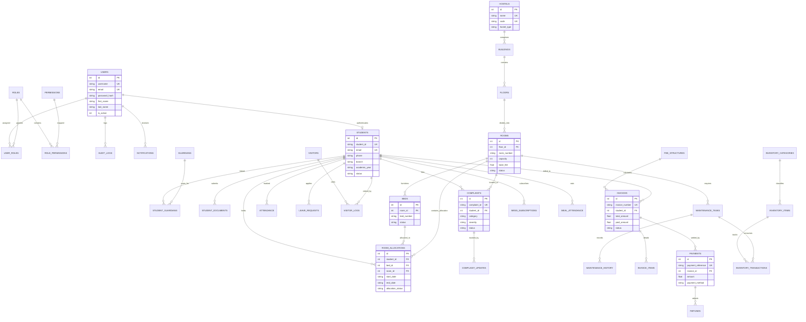

# Entity Relationship (ER) Diagram — Hostel Management System Web App

**Course:** BBAT104 – Fundamentals of Total Quality Management (TQM)  
**Assigned Quality Goal:** Q05 – Reduce Response Time  

